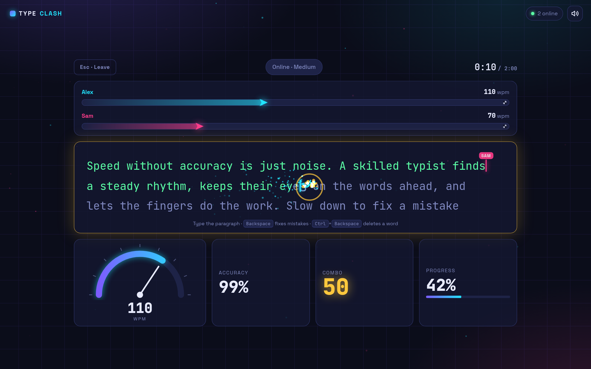

# TypeClash

A real-time **1v1 typing race** for the browser. You and an opponent type the same paragraph at the same time. The server is the referee, so results are fair.



## Features

- **Modes:** Quick Match (random opponent), Private Room (share a 4-letter code), vs Bot (4 speeds), Solo practice
- **Live race:** smooth caret, sparks, combo bursts, WPM gauge, accuracy, rival's live position, sounds (all generated in the browser)
- **Progression:** accounts (name + PIN), coins, Elo ranked ladder (Bronze to Master), daily quests, **one hard weekly quest** with an animated legend badge, 19 achievements, shop (caret skins, name styles)
- **Leaderboards:** Ranked, Fastest, Legends
- **Chaos mode:** earn Freeze, Blur and Shield power-ups with clean typing, press Tab to use them
- **My Stats:** race history, keyboard heatmap of the letters you miss, daily goal, weak-key drills
- **AI (DeepSeek, optional):** topic paragraphs, AI Coach tips, AI-written drills. The API key stays on the server
- **Built to run:** Docker, SQLite with automatic backups, graceful restarts, online player cap, load-test tool

See [`design/overview.png`](design/overview.png) for every screen.

## Quick start

**With Docker (recommended)**

```bash
cp .env.example .env          # then edit .env (all settings are optional)
docker compose up -d --build
```

Open http://localhost:3001. Friends on your Wi-Fi use your computer's address and port 3001.

**Without Docker** (Node.js 22.13 or newer)

```bash
npm install
npm start                     # http://localhost:3001 (port from .env, default 3000)
```

## Settings (`.env`)

| Setting | What it does |
|---|---|
| `DEEPSEEK_API_KEY` | turns on the AI features (get a key at platform.deepseek.com) |
| `DEEPSEEK_THINKING=disabled` | recommended: about 3x faster AI replies |
| `MAX_ONLINE=400` | most players using Quick Match / Private Room at once; extra visitors can still play vs Bot / Solo |
| `AI_DAILY_CAP`, `AI_PER_IP`, `AI_REQUIRE_LOGIN` | limits that protect your AI credits |
| `DOMAIN`, `TRUST_PROXY=1`, `BIND_ADDR=127.0.0.1` | for a public HTTPS domain (see `PLAN.md`, section 15) |

Never commit `.env`. It is in `.gitignore`.

Test your AI key: `docker compose exec typeclash node scripts/ai-check.js` (or `npm run ai:check`).

## Tests

```bash
npm test                      # 100 automated tests (no real API calls, no real database)
npm run loadtest -- --help    # load-test tool (use a throwaway server, see PLAN.md)
```

## How it is built

- **Server:** Node.js, `ws` (WebSocket), Node's built-in SQLite. Server-side refereeing, anti-cheat speed limits, rate limits
- **Browser:** plain JavaScript modules, Canvas, Web Audio. No framework and no build step
- **Capacity (measured):** about 1,000 to 1,500 players at once on one small server; see `PLAN.md`, section 15

```
server/    game server: matchmaking, rooms, accounts, economy (coins, Elo, quests), AI
public/    the game in the browser (HTML, CSS, JS modules)
test/      automated tests
scripts/   ai-check, loadtest
design/    screenshots of every screen
PLAN.md    rules, protocol, economy, operations, going public
```

## Known limits

Accuracy is reported by the browser (speed and winners are checked by the server). PIN accounts are for fun: do not reuse a real password.
One server process is the design limit, so beyond a few thousand simultaneous players it needs several servers, Redis and a shared database.
